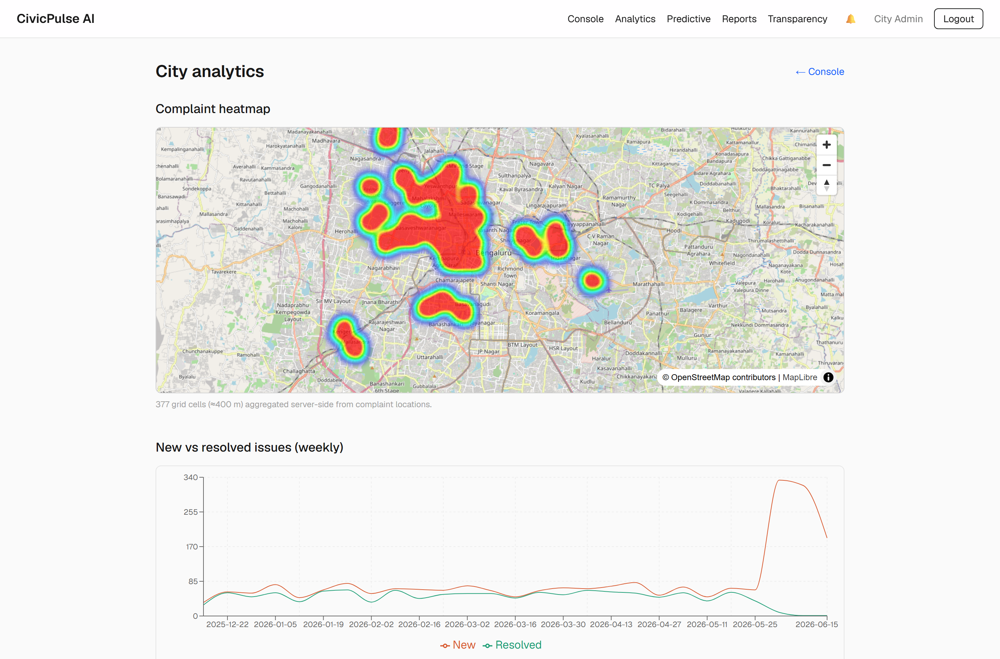
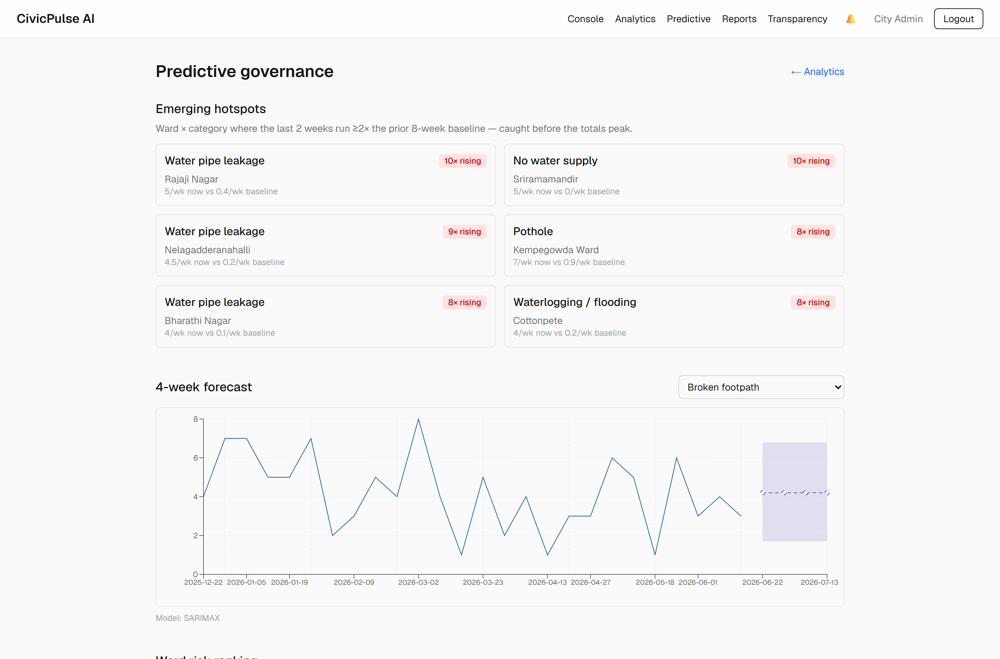
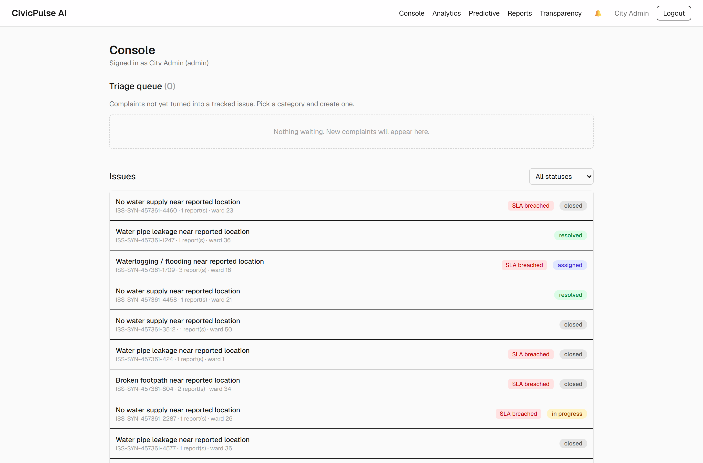
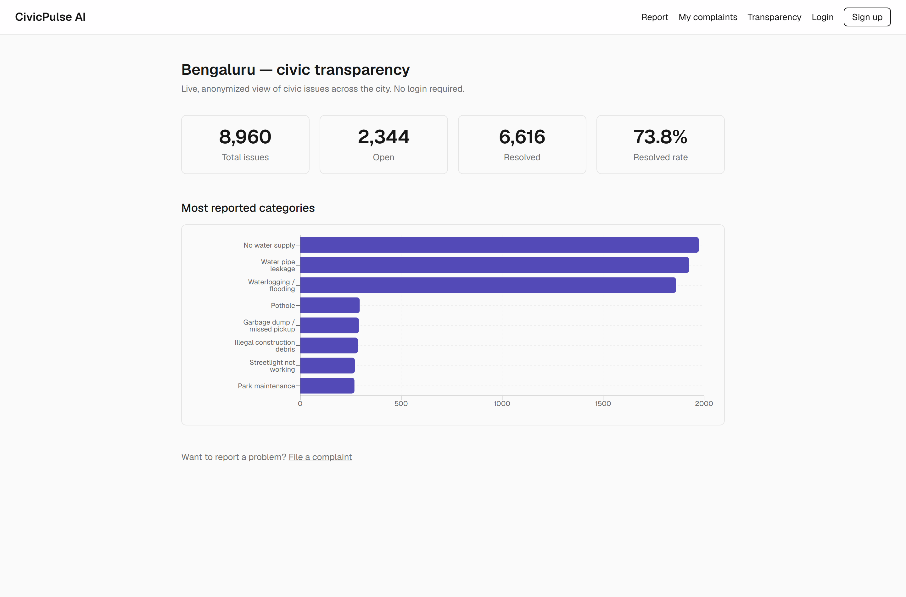
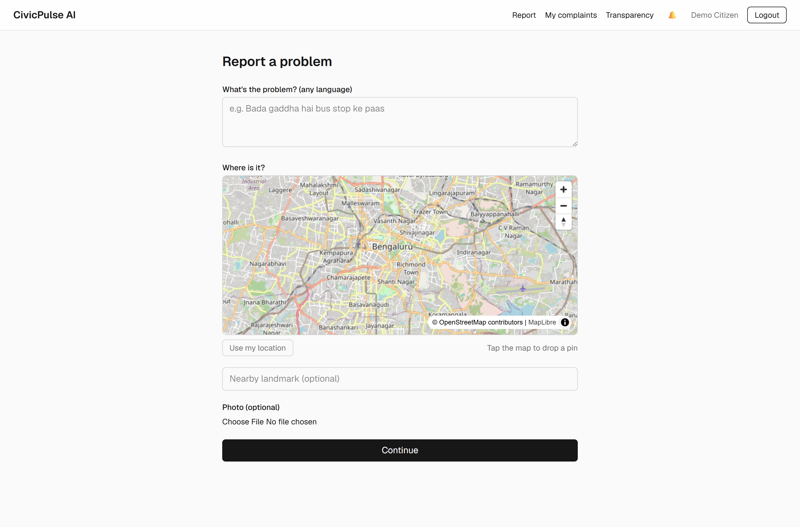

# CivicPulse AI — Predictive Urban Governance Platform

<p align="center">
  
  
  
  
  
  
  
</p>

Most civic complaint systems are reactive and complaint-centric: fifty residents
report the same pothole, the city opens fifty tickets, fixes one hole, closes one
ticket, and forty-nine people feel ignored.

**CivicPulse inverts that.** It's a funnel that turns noisy, multilingual citizen
reports into a prioritized work queue and city-level intelligence:

```
many COMPLAINTS  →  deduplicated ISSUES  →  prioritized WORK QUEUES  →  city INTELLIGENCE
  (citizen)         (NLP + geospatial)       (scoring · SLA · routing)   (trends · hotspots · forecasts)
```

The one load-bearing idea: an **Issue** (the real-world problem) is a first-class
entity, separate from a **Complaint** (one person's report of it). Deduplication
*is* attaching a new complaint to an existing issue. Every government-facing screen
operates on issues; every citizen-facing screen on complaints.

Pilot city: **Bengaluru** (real BBMP ward boundaries).

---

<p align="center">
  <br>
  <sub><b>City analytics</b> — live complaint heatmap (PostGIS grid) + weekly new-vs-resolved trend.</sub>
</p>

<table>
  <tr>
    <td width="50%" valign="top">
      <br>
      <sub><b>Predictive governance</b> — emerging hotspots + SARIMA forecast with confidence band.</sub>
    </td>
    <td width="50%" valign="top">
      <br>
      <sub><b>Official console</b> — deduplicated, priority-scored issue queue with SLA badges.</sub>
    </td>
  </tr>
  <tr>
    <td width="50%" valign="top">
      <br>
      <sub><b>Public dashboard</b> — anonymized, no-login city transparency view.</sub>
    </td>
    <td width="50%" valign="top">
      <br>
      <sub><b>Citizen report</b> — map pin + photo, in any language, with a duplicate intercept.</sub>
    </td>
  </tr>
</table>

---

## What it does (all live)

**Citizens** — sign up (email OTP), report in any language with a map pin + photo, get
a **pre-submit duplicate intercept** ("this is already reported — notify me too (+1)"),
track issues, and confirm/reopen resolutions.

**AI pipeline** — language detect → multilingual embedding → zero-shot
categorization → **duplicate detection** (pgvector + PostGIS in one query) →
auto-attach or create issue → transparent priority score → computer-vision photo
analysis. Runs off the request path; fully offline in `MOCK_AI` mode.

**Officials / admins** — a deduplicated, prioritized triage queue; issue lifecycle
with audit trail, assignment, SLAs; **analytics** (heatmap, trends, department
performance); **predictive governance** (emerging hotspots, SARIMA forecasts with
confidence intervals, ward risk scores, LLM root-cause hypotheses); weekly AI
reports; a public, anonymized transparency dashboard.

## AI — honest numbers

Measured on a hand-labeled eval set with the same model the app uses
(`paraphrase-multilingual-MiniLM-L12-v2`, 384-d, ONNX). Reproduce:
`cd backend && uv run python ../ml/eval/run_eval.py`.

| Capability | Result | Notes |
|---|---|---|
| Duplicate detection — auto-merge | **precision 1.00**, recall 0.69 @ 0.65 | no-human merge → precision-first |
| Duplicate detection — intercept | precision 0.83, recall 0.77 @ 0.60 | human decides → recall-favored |
| Category top-1 (zero-shot) | 0.77 | misses are mostly Hindi/Hinglish; officials correct → labeled flywheel |
| Forecasting | SARIMA + 80% CI | trend only (≈14 mo data ≠ annual seasonality) — stated, not oversold |
| Photo CV | Gemini Vision zero-shot | verifies/enriches, never gates; YOLO fine-tune is a post-MVP stretch |

The thresholds above were **calibrated from the eval set, not guessed** — the naive
0.78/0.88 gave auto-merge recall 0.0. See [ml/eval/README.md](ml/eval/README.md).

## Architecture

Two backend deployables (a slim `api` and an `ai` worker, decoupled by a Redis
queue), Postgres doing triple duty (relational + PostGIS geospatial + pgvector
similarity — which is why dedup is one SQL statement and FAISS isn't needed), and a
Next.js frontend. One real service boundary, not ten nano-services — drawn where the
dependency weight and scaling profile actually differ.

```
Next.js ──REST──> FastAPI api ──enqueue──> Redis ──> arq worker ──> Gemini (adapter+mock)
                       │                                   │
                       └──────────> PostgreSQL (PostGIS + pgvector) <──┘
   browser ──presigned PUT/GET──> MinIO / R2 (photos)
```

Stack: **Next.js 16 · Tailwind · FastAPI · PostgreSQL 16 (PostGIS + pgvector) ·
Redis + arq · MinIO/R2 · fastembed (ONNX) · statsmodels · Gemini Flash · Docker · Caddy.**

The "why" behind every choice (pgvector over FAISS, modular monolith, arq over
Celery, classical forecasting, …) is recorded as ADRs in
[docs/05-architecture.md](docs/05-architecture.md). Full planning set —
PRD, user flows, DB schema, API contracts, build plan — in [docs/](docs/README.md).

## Run it (dev)

Prereqs: Docker Desktop, Node 22 + pnpm, [uv](https://docs.astral.sh/uv/).

```powershell
docker compose up -d                       # postgres(+postgis+pgvector), redis, minio
Copy-Item .env.example backend\.env
cd backend
uv run alembic upgrade head                # schema
uv run python -m scripts.seed              # 7 depts, 15 categories, 243 BBMP wards, staff
uv run python -m scripts.generate_synthetic  # ~14 months of demo data (optional)
uv run uvicorn app.main:app --reload --port 8000
# new terminal:
cd frontend ; pnpm install ; pnpm dev
```

Open **http://localhost:3000**. API docs: `http://localhost:8000/api/v1/docs`.

**Demo accounts** (from the seed): admin `admin@civicpulse.gov.in`, department heads
`official.<dept>@civicpulse.gov.in` (e.g. `official.roads@…`) — all password
`civicpulse123`. Citizens self-register; in dev the OTP shows on screen.

`uv run python -m scripts.reset_demo` resets to a clean, coherent demo state.

## Deploy

Containerized, single-origin behind Caddy (auto-HTTPS): one public URL with `/` →
frontend, `/api` → API, `/civicpulse-media` → object storage. Deploy to a real VM,
run local prod, or share instantly over a no-account Cloudflare tunnel:

```powershell
docker compose --env-file .env.prod -f docker-compose.prod.yml up -d --build
docker compose --env-file .env.prod -f docker-compose.prod.yml run --rm api .venv/bin/python -m scripts.seed
powershell -ExecutionPolicy Bypass -File scripts\share.ps1   # → prints a public URL via Cloudflare tunnel
```

The frontend image talks to the API on a relative path, so it's independent of the
(ephemeral) public URL — `share.ps1` brings up the stack, opens the tunnel, wires the
fresh URL into `.env.prod`, and recreates the API. Full guide (env vars, the three
deploy paths, presigned-photo + refresh-cookie gotchas) in [docs/DEPLOY.md](docs/DEPLOY.md).

## Tests & quality

```powershell
cd backend
uv run pytest -m "not integration"   # unit (CI)
uv run pytest                        # + integration (needs docker compose up)
uv run ruff check . ; uv run ruff format --check .
```
47 backend tests; CI runs ruff + pytest + the frontend production build.

## Repository layout

```
docs/        PRD, user flows, DB schema, API contracts, architecture ADRs, deploy guide
backend/     FastAPI app, arq worker, AI pipeline, Alembic migrations, tests, scripts
frontend/    Next.js app (citizen portal, official console, admin, public dashboard)
infra/       Postgres image (PostGIS + pgvector), Caddyfile
ml/eval/     hand-labeled eval set + offline metrics script
```

## Honest limitations

Single-tenant (one city per deployment). Categorization is zero-shot (0.77) with a
correction flywheel, not a trained classifier yet. Forecasts capture trend, not
annual seasonality, on this much data. CV is zero-shot (Gemini) — the fine-tuned YOLO
detector and PDF report export are documented post-MVP work. The eval set is small
(indicative, not production-grade). These are deliberate, documented trade-offs — not
hidden gaps.

## License

[MIT](LICENSE) © 2026 Kali Singh.
