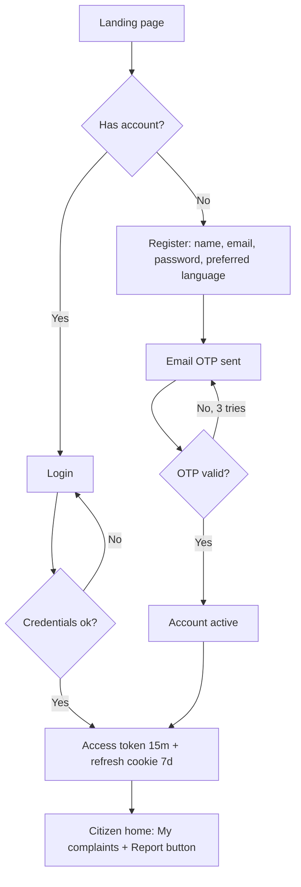
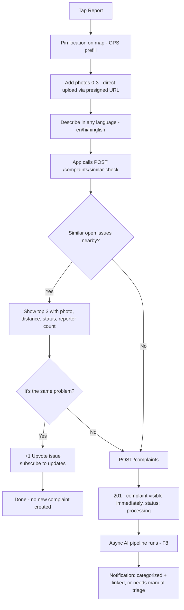
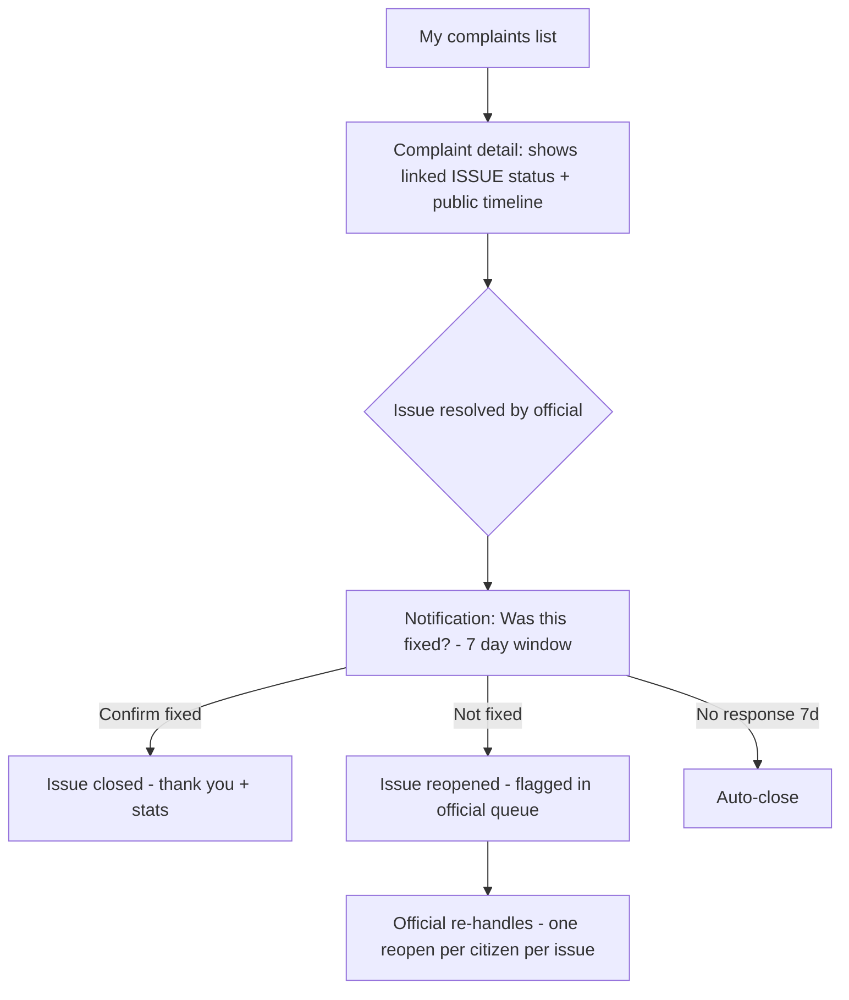
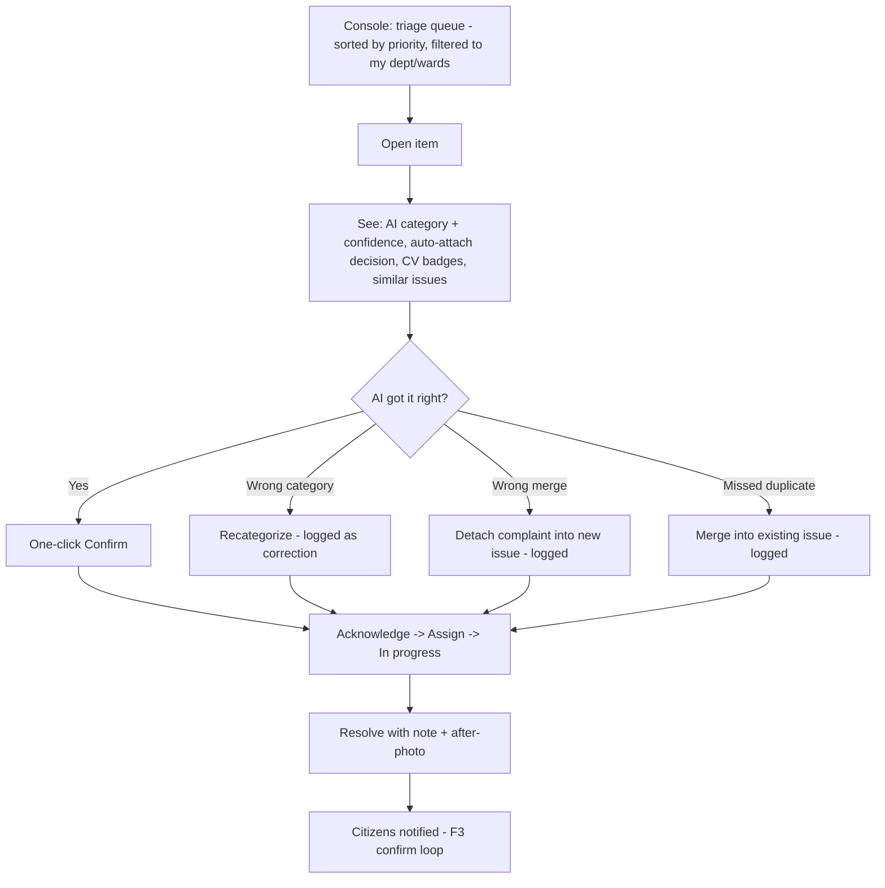
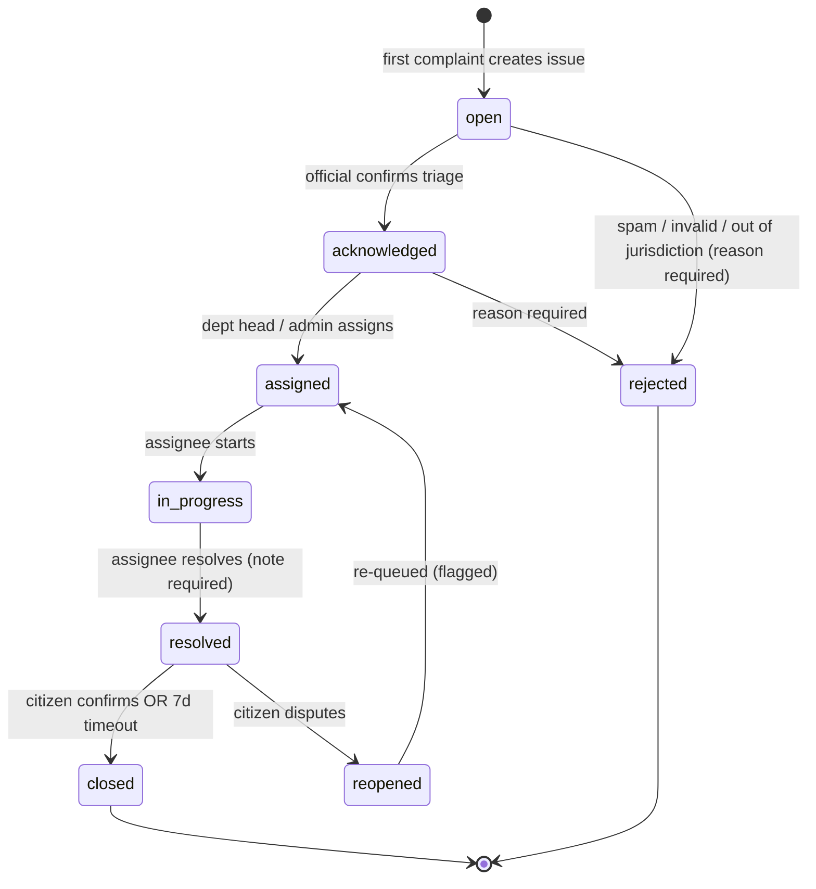
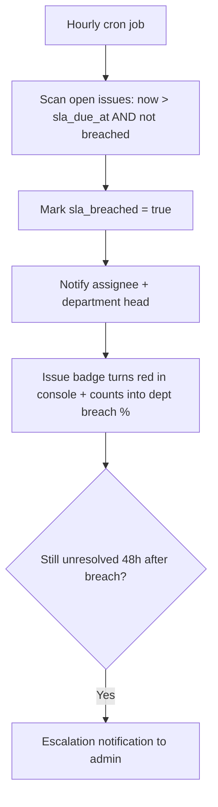
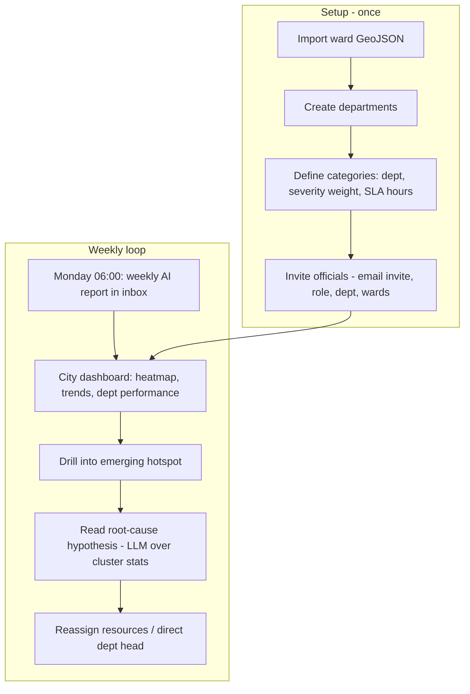
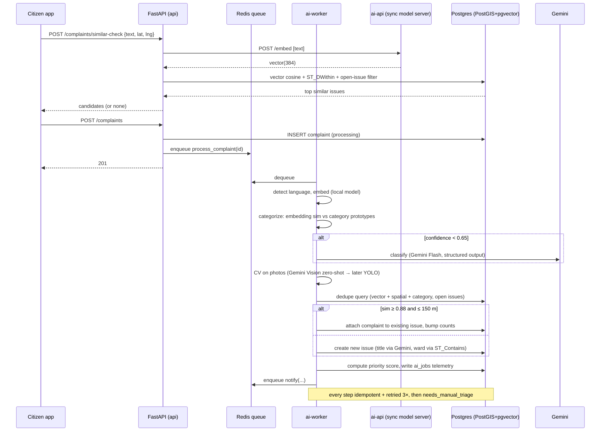

# User Flows — CivicPulse AI

Flows are numbered F1–F8. Mermaid renders on GitHub and in VS Code (Markdown Preview Mermaid extension).

---

## F1 — Citizen registration & login

Notes:
- Officials and admins never appear in this flow — they are invited (F7) and land on `/console`.
- Rate limit: 5 login attempts/min/IP. Generic "invalid credentials" error (no user enumeration).
- Refresh token rotates on every use; reuse of a rotated token revokes the whole session family (standard rotation defense).

---

## F2 — Submit complaint (the core flow — with duplicate intercept)

Design rules:
- **The intercept is a suggestion, never a wall.** "No, file new" is always available — false-positive matches must not block reporting.
- Similar-check needs: same coarse category guess (optional), within 150 m, open issues only, text cosine similarity ≥ 0.78 to even show. Show at most 3.
- Photos upload while the user types (presigned PUT direct to object storage) — perceived speed.
- Edge cases: offline → queue submission locally (PWA, later); no GPS → manual pin required; submission with no similar-check call (API consumers) is fine — the pipeline still dedupes.

---

## F3 — Citizen tracks complaint → resolution confirm

Notes:
- The citizen sees **the issue's** status and timeline (public entries only) — they benefit from the merged view: "you + 12 others reported this".
- Anti-abuse: reopen requires a reason; one reopen per citizen per issue.

---

## F4 — Official triage queue (AI suggestions → human decisions)

Notes:
- **Every correction (F, G, H) is written to a `corrections` log — this is the data flywheel.** Months of triage = a labeled dataset to train a supervised categorizer and tune dedup thresholds.
- Auto-attach happens only at sim ≥ 0.88 AND ≤ 150 m AND same category; between 0.78–0.88 the pipeline creates/keeps the complaint separate but shows "possible duplicate" hints at triage.
- Officials see only their department + wards; department heads see the whole department; admins see everything.

---

## F5 — Issue lifecycle (state machine)

Every transition writes `issue_status_history` (who, when, from, to, note). This table **is** the audit log and the source for resolution-time analytics — never compute resolution time from `updated_at`.

---

## F6 — SLA escalation (system flow, no human trigger)

SLA hours live on the category (e.g., water leak 24h, pothole 72h, faded signage 240h) and are admin-editable.

---

## F7 — Admin: configuration & intelligence loop

---

## F8 — AI pipeline (system sequence — the architectural spine)

Failure rule: **AI failure never loses a complaint.** Worst case, a complaint sits in `needs_manual_triage` and an official handles it like a legacy ticket.
