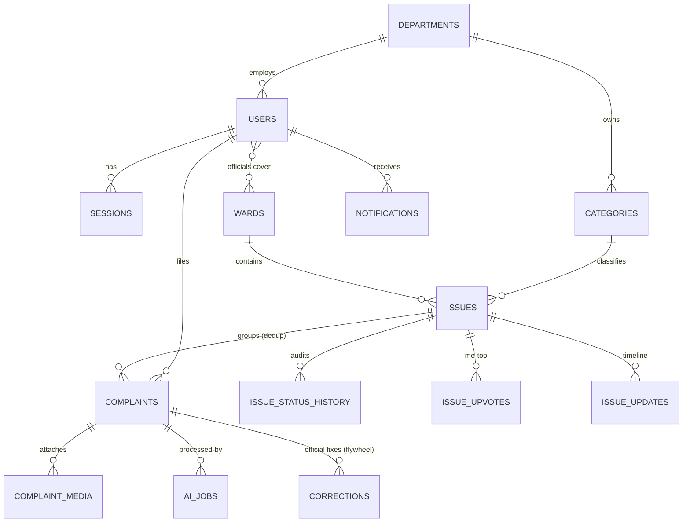

# Database Schema — PostgreSQL 16 + PostGIS + pgvector

## Modeling principles

1. **Issue-centric.** `complaints` are raw input; `issues` are the unit of work. Every complaint ends up attached to exactly one issue (dedup = attach to existing; otherwise the pipeline creates a new issue of size 1). There is no "standalone complaint" after triage.
2. **One database does three jobs.** Relational data, geospatial queries (PostGIS), and vector similarity (pgvector) live together — so duplicate detection is **one SQL query** combining all three. This replaces FAISS entirely at this scale (see ADR-02).
3. **Audit by append.** Status changes, AI decisions, and official corrections are append-only logs (`issue_status_history`, `ai_jobs`, `corrections`). Analytics and the training-data flywheel read from these — never recompute history from `updated_at`.
4. **Source of truth for status is the issue.** Citizens see their complaint's *issue* status. Complaints only track pipeline state (`processing_status`).
5. **Transparent AI columns.** Wherever AI writes a decision, it writes its confidence and inputs alongside (`ai_category_confidence`, `priority_factors` jsonb) — so the UI can show *why*, and so you can debug.

## Entity overview



## DDL

Runnable top-to-bottom on PostgreSQL 16. Canonical source will be Alembic migrations; this file stays the human-readable reference.

```sql
CREATE EXTENSION IF NOT EXISTS postgis;
CREATE EXTENSION IF NOT EXISTS vector;
CREATE EXTENSION IF NOT EXISTS citext;

-- ---------- enums ----------
CREATE TYPE user_role             AS ENUM ('citizen','official','admin');
CREATE TYPE processing_status     AS ENUM ('queued','processing','triaged','needs_manual_triage','rejected');
CREATE TYPE issue_status          AS ENUM ('open','acknowledged','assigned','in_progress','resolved','closed','reopened','rejected');
CREATE TYPE cv_status             AS ENUM ('pending','done','failed','skipped');
CREATE TYPE moderation_status     AS ENUM ('pending','approved','flagged');
CREATE TYPE correction_kind       AS ENUM ('recategorize','detach','merge','priority_override','reject');
CREATE TYPE ai_job_status         AS ENUM ('queued','running','succeeded','failed');
CREATE TYPE notification_channel  AS ENUM ('inapp','email');

-- ---------- lookup / admin-managed ----------
CREATE TABLE departments (
    id          smallserial PRIMARY KEY,
    name        text NOT NULL UNIQUE,
    name_hi     text,
    is_active   boolean NOT NULL DEFAULT true
);

CREATE TABLE wards (
    id          smallserial PRIMARY KEY,
    ward_code   text NOT NULL UNIQUE,          -- code from the city's official GeoJSON
    name        text NOT NULL,
    zone        text,
    geom        geometry(MultiPolygon, 4326) NOT NULL
);
CREATE INDEX wards_geom_gix ON wards USING gist (geom);

CREATE TABLE categories (
    id              smallserial PRIMARY KEY,
    department_id   smallint NOT NULL REFERENCES departments(id),
    parent_id       smallint REFERENCES categories(id),
    name            text NOT NULL UNIQUE,
    name_hi         text,
    description     text NOT NULL,             -- written for humans AND used to build the prototype embedding
    embedding       vector(384),               -- prototype embedding of description (zero-shot classification target)
    severity_weight smallint NOT NULL DEFAULT 3 CHECK (severity_weight BETWEEN 1 AND 5),
    sla_hours       integer  NOT NULL DEFAULT 168,
    is_active       boolean  NOT NULL DEFAULT true
);

-- ---------- identity ----------
CREATE TABLE users (
    id                 uuid PRIMARY KEY DEFAULT gen_random_uuid(),
    role               user_role NOT NULL DEFAULT 'citizen',
    email              citext NOT NULL UNIQUE,
    password_hash      text NOT NULL,                       -- argon2id
    full_name          text NOT NULL,
    phone              text,
    preferred_language char(2) NOT NULL DEFAULT 'en',
    department_id      smallint REFERENCES departments(id), -- officials only
    is_department_head boolean NOT NULL DEFAULT false,
    email_verified_at  timestamptz,
    is_active          boolean NOT NULL DEFAULT true,
    created_at         timestamptz NOT NULL DEFAULT now(),
    updated_at         timestamptz NOT NULL DEFAULT now()
);

CREATE TABLE official_wards (                                -- which wards an official covers
    user_id uuid     NOT NULL REFERENCES users(id) ON DELETE CASCADE,
    ward_id smallint NOT NULL REFERENCES wards(id),
    PRIMARY KEY (user_id, ward_id)
);

CREATE TABLE sessions (                                      -- refresh-token rotation families
    id          uuid PRIMARY KEY DEFAULT gen_random_uuid(),
    user_id     uuid NOT NULL REFERENCES users(id) ON DELETE CASCADE,
    family_id   uuid NOT NULL,                               -- reuse of a rotated token revokes the family
    token_hash  text NOT NULL,
    user_agent  text,
    ip          inet,
    expires_at  timestamptz NOT NULL,
    revoked_at  timestamptz,
    created_at  timestamptz NOT NULL DEFAULT now()
);
CREATE INDEX sessions_user_idx   ON sessions (user_id);
CREATE INDEX sessions_family_idx ON sessions (family_id);

-- ---------- core domain ----------
CREATE TABLE issues (
    id              uuid PRIMARY KEY DEFAULT gen_random_uuid(),
    public_code     text NOT NULL UNIQUE,                    -- "ISS-2026-00042"
    title           text NOT NULL,                           -- AI-generated, official-editable
    category_id     smallint NOT NULL REFERENCES categories(id),
    department_id   smallint NOT NULL REFERENCES departments(id),
    ward_id         smallint NOT NULL REFERENCES wards(id),
    centroid        geography(Point, 4326) NOT NULL,         -- recomputed when complaints attach
    status          issue_status NOT NULL DEFAULT 'open',
    priority_score  real NOT NULL DEFAULT 0,                 -- 0..100
    priority_factors jsonb,                                  -- {"severity":..,"volume":..,"age":..,"cv":..} transparency
    complaint_count integer NOT NULL DEFAULT 0,
    upvote_count    integer NOT NULL DEFAULT 0,
    first_reported_at timestamptz NOT NULL,
    sla_due_at      timestamptz NOT NULL,
    sla_breached    boolean NOT NULL DEFAULT false,
    assigned_to     uuid REFERENCES users(id),
    resolved_at     timestamptz,
    resolution_note text,
    closed_at       timestamptz,
    reopen_count    smallint NOT NULL DEFAULT 0,
    created_at      timestamptz NOT NULL DEFAULT now(),
    updated_at      timestamptz NOT NULL DEFAULT now()
);
CREATE INDEX issues_centroid_gix      ON issues USING gist (centroid);
CREATE INDEX issues_queue_idx         ON issues (department_id, status, priority_score DESC);
CREATE INDEX issues_ward_status_idx   ON issues (ward_id, status);
CREATE INDEX issues_open_partial_idx  ON issues (status) WHERE status NOT IN ('closed','rejected');

CREATE TABLE complaints (
    id                     uuid PRIMARY KEY DEFAULT gen_random_uuid(),
    public_code            text NOT NULL UNIQUE,             -- "CP-2026-000123" (citizen-facing reference)
    citizen_id             uuid NOT NULL REFERENCES users(id),
    issue_id               uuid REFERENCES issues(id),       -- NULL only while pipeline/manual triage pending
    description            text NOT NULL,
    language               char(2),
    location               geography(Point, 4326) NOT NULL,
    address_text           text,
    ward_id                smallint REFERENCES wards(id),    -- derived: ST_Contains(ward.geom, location)
    category_id            smallint REFERENCES categories(id),   -- final (AI, then official-confirmed)
    ai_category_id         smallint REFERENCES categories(id),   -- what AI said (kept even after correction)
    ai_category_confidence real,
    embedding              vector(384),                      -- multilingual-e5-small, "query:"-prefixed
    processing_status      processing_status NOT NULL DEFAULT 'queued',
    declined_intercept     boolean NOT NULL DEFAULT false,   -- user saw similar issues and filed anyway (threshold-tuning signal)
    submitted_via          text NOT NULL DEFAULT 'web',
    created_at             timestamptz NOT NULL DEFAULT now(),
    updated_at             timestamptz NOT NULL DEFAULT now()
);
CREATE INDEX complaints_location_gix ON complaints USING gist (location);
CREATE INDEX complaints_issue_idx    ON complaints (issue_id);
CREATE INDEX complaints_citizen_idx  ON complaints (citizen_id, created_at DESC);
CREATE INDEX complaints_pending_idx  ON complaints (processing_status)
    WHERE processing_status IN ('queued','processing','needs_manual_triage');
-- HNSW for cosine distance. At student scale exact scan is also fine; index added for the learning value.
CREATE INDEX complaints_embedding_idx ON complaints
    USING hnsw (embedding vector_cosine_ops);

CREATE TABLE complaint_media (
    id           uuid PRIMARY KEY DEFAULT gen_random_uuid(),
    complaint_id uuid NOT NULL REFERENCES complaints(id) ON DELETE CASCADE,
    object_key   text NOT NULL,                              -- key in S3/R2, never a public URL
    mime         text NOT NULL,
    bytes        integer NOT NULL,
    width        integer,
    height       integer,
    exif_gps     geography(Point, 4326),                     -- kept internally for location verification; stripped on public serve
    cv_status    cv_status NOT NULL DEFAULT 'pending',
    cv_result    jsonb,                                      -- [{"label":"pothole","conf":0.91,"bbox":[x,y,w,h]}]
    moderation   moderation_status NOT NULL DEFAULT 'pending',
    created_at   timestamptz NOT NULL DEFAULT now()
);
CREATE INDEX complaint_media_complaint_idx ON complaint_media (complaint_id);

-- ---------- audit & engagement ----------
CREATE TABLE issue_status_history (
    id          bigserial PRIMARY KEY,
    issue_id    uuid NOT NULL REFERENCES issues(id) ON DELETE CASCADE,
    from_status issue_status,
    to_status   issue_status NOT NULL,
    actor_id    uuid REFERENCES users(id),                   -- NULL = system (auto-close, SLA job)
    note        text,
    created_at  timestamptz NOT NULL DEFAULT now()
);
CREATE INDEX ish_issue_idx ON issue_status_history (issue_id, created_at);

CREATE TABLE issue_upvotes (
    issue_id   uuid NOT NULL REFERENCES issues(id) ON DELETE CASCADE,
    user_id    uuid NOT NULL REFERENCES users(id) ON DELETE CASCADE,
    created_at timestamptz NOT NULL DEFAULT now(),
    PRIMARY KEY (issue_id, user_id)
);

CREATE TABLE issue_updates (                                 -- official timeline entries
    id          uuid PRIMARY KEY DEFAULT gen_random_uuid(),
    issue_id    uuid NOT NULL REFERENCES issues(id) ON DELETE CASCADE,
    author_id   uuid NOT NULL REFERENCES users(id),
    body        text NOT NULL,
    photo_key   text,                                        -- e.g. after-fix photo
    is_internal boolean NOT NULL DEFAULT false,              -- internal notes hidden from citizens
    created_at  timestamptz NOT NULL DEFAULT now()
);

CREATE TABLE corrections (                                   -- THE DATA FLYWHEEL: official fixes to AI decisions
    id           bigserial PRIMARY KEY,
    complaint_id uuid NOT NULL REFERENCES complaints(id),
    official_id  uuid NOT NULL REFERENCES users(id),
    kind         correction_kind NOT NULL,
    before       jsonb NOT NULL,                             -- e.g. {"category_id": 4, "issue_id": "..."}
    after        jsonb NOT NULL,
    created_at   timestamptz NOT NULL DEFAULT now()
);

-- ---------- ops, notifications, analytics ----------
CREATE TABLE ai_jobs (                                       -- telemetry for every pipeline step
    id           bigserial PRIMARY KEY,
    job_type     text NOT NULL,                              -- embed|classify|cv|dedupe|score|title|report
    complaint_id uuid REFERENCES complaints(id),
    media_id     uuid REFERENCES complaint_media(id),
    status       ai_job_status NOT NULL DEFAULT 'queued',
    attempts     smallint NOT NULL DEFAULT 0,
    model        text,                                       -- "e5-small" | "gemini-2.x-flash" | "yolo11n-civic"
    latency_ms   integer,
    confidence   real,
    error        text,
    payload      jsonb,
    created_at   timestamptz NOT NULL DEFAULT now(),
    finished_at  timestamptz
);
CREATE INDEX ai_jobs_complaint_idx ON ai_jobs (complaint_id);

CREATE TABLE notifications (
    id           uuid PRIMARY KEY DEFAULT gen_random_uuid(),
    user_id      uuid NOT NULL REFERENCES users(id) ON DELETE CASCADE,
    kind         text NOT NULL,                              -- status_change|sla_breach|resolution_confirm|report_ready
    title        text NOT NULL,
    body         text,
    issue_id     uuid REFERENCES issues(id),
    channel      notification_channel NOT NULL DEFAULT 'inapp',
    read_at      timestamptz,
    emailed_at   timestamptz,
    created_at   timestamptz NOT NULL DEFAULT now()
);
CREATE INDEX notifications_inbox_idx ON notifications (user_id, created_at DESC) WHERE read_at IS NULL;

CREATE TABLE reports (
    id           uuid PRIMARY KEY DEFAULT gen_random_uuid(),
    period_start date NOT NULL,
    period_end   date NOT NULL,
    scope        text NOT NULL DEFAULT 'city',               -- city | dept:<id> | ward:<id>
    stats        jsonb NOT NULL,                             -- the numbers handed to the LLM (traceability)
    content_md   text,
    pdf_key      text,
    created_at   timestamptz NOT NULL DEFAULT now()
);

CREATE TABLE daily_stats (                                   -- precomputed; dashboards & forecasting read ONLY this
    day                  date NOT NULL,
    ward_id              smallint NOT NULL REFERENCES wards(id),
    category_id          smallint NOT NULL REFERENCES categories(id),
    new_complaints       integer NOT NULL DEFAULT 0,
    new_issues           integer NOT NULL DEFAULT 0,
    resolved_issues      integer NOT NULL DEFAULT 0,
    reopened_issues      integer NOT NULL DEFAULT 0,
    sla_breaches         integer NOT NULL DEFAULT 0,
    upvotes              integer NOT NULL DEFAULT 0,
    avg_resolution_hours real,
    PRIMARY KEY (day, ward_id, category_id)
);
```

## The queries that justify this design

### 1. Duplicate detection — relational + spatial + vector in one statement

```sql
-- Candidates for a new complaint: open issues, same category, within 150 m,
-- ranked by best text similarity among their attached complaints.
SELECT i.id, i.public_code, i.title, i.status, i.complaint_count,
       1 - MIN(c.embedding <=> :new_embedding)            AS best_similarity,
       MIN(ST_Distance(c.location, :new_point::geography)) AS meters
FROM issues i
JOIN complaints c ON c.issue_id = i.id
WHERE i.status NOT IN ('resolved','closed','rejected')
  AND i.category_id = :category_id
  AND ST_DWithin(c.location, :new_point::geography, 150)
GROUP BY i.id
HAVING 1 - MIN(c.embedding <=> :new_embedding) >= 0.78
ORDER BY best_similarity DESC
LIMIT 3;
```

This single query is why FAISS was dropped: with FAISS you'd run a vector search in one system, then re-filter by category/geography/status in Postgres, and keep both stores in sync forever. Caveat to know: combining an HNSW index with strict filters can under-return (the index prunes before the filter applies); at <1M rows Postgres will often just scan exactly — which is correct and fast enough here.

### 2. Ward assignment (point-in-polygon)

```sql
SELECT id FROM wards WHERE ST_Contains(geom, ST_SetSRID(:point, 4326)) LIMIT 1;
```

### 3. Heatmap aggregation (never ship 100k raw points)

```sql
SELECT ST_X(g) AS lng, ST_Y(g) AS lat, count(*) AS weight
FROM (
  SELECT ST_SnapToGrid(location::geometry, 0.004) AS g    -- ≈ 400 m cells
  FROM complaints
  WHERE created_at >= :from AND (:category_id IS NULL OR category_id = :category_id)
) t GROUP BY g;
```

### 4. Spatial clustering for hotspots (no Python needed)

```sql
SELECT id, centroid,
       ST_ClusterDBSCAN(centroid::geometry, eps := 0.003, minpoints := 5) OVER () AS cluster_id
FROM issues
WHERE status NOT IN ('closed','rejected');
```

### 5. SLA breach scan (hourly job)

```sql
UPDATE issues SET sla_breached = true
WHERE sla_breached = false
  AND status IN ('open','acknowledged','assigned','in_progress','reopened')
  AND now() > sla_due_at
RETURNING id, assigned_to, department_id;
```

## Priority score v1 (transparent rules — stored in `priority_factors`)

```
priority = 100 * normalize(
    0.35 * severity_weight/5                          -- what kind of problem
  + 0.25 * log1p(complaint_count + upvote_count)/log1p(50)   -- how many people it affects
  + 0.20 * min(age_days/14, 1)                        -- how long it has waited
  + 0.10 * cv_severity                                -- CV signal (e.g. pothole area ratio), 0 if none
  + 0.10 * sensitive_poi_proximity                    -- near school/hospital (later; 0 in MVP)
)
```

Weights live in a config table/env so officials' feedback can tune them without a deploy. When months of `corrections` + resolution data exist, train a learning-to-rank model and A/B it against the rules — that's the honest path to "AI priority prediction".

## Seed categories (starter set)

| Category | Department | severity_weight | sla_hours |
|---|---|---|---|
| Pothole | Roads | 4 | 72 |
| Road cracking / damage | Roads | 3 | 168 |
| Broken footpath | Roads | 2 | 240 |
| Garbage dump / missed pickup | Sanitation | 3 | 48 |
| Dead animal | Sanitation | 4 | 24 |
| Public toilet unclean | Sanitation | 2 | 72 |
| Water pipe leakage | Water | 4 | 24 |
| Waterlogging / flooding | Water (Storm) | 5 | 24 |
| No water supply | Water | 4 | 48 |
| Streetlight not working | Electrical | 3 | 96 |
| Dangling wires | Electrical | 5 | 24 |
| Fallen tree / branches | Parks | 4 | 48 |
| Park maintenance | Parks | 1 | 336 |
| Illegal construction debris | Enforcement | 2 | 168 |
| Stray animal menace | Health | 3 | 96 |

## Operational notes

- **Migrations:** Alembic from day one; the first migration enables extensions. Never edit an applied migration.
- **Counters:** `complaint_count`/`upvote_count` are denormalized for queue sorting — update them in the same transaction as the insert (or a trigger), and add a nightly reconciliation job.
- **Embedding model is pinned** (`intfloat/multilingual-e5-small`, 384-d). Changing models means re-embedding everything — record model name in `ai_jobs` so a migration is possible.
- **Privacy/retention:** reporter identity never joins into public endpoints; EXIF GPS kept only in `complaint_media.exif_gps`; consider purging media N months after issue closure.
- **`daily_stats`** is rebuilt incrementally each night (and backfilled by the seed script). Dashboards and SARIMA forecasts must read only this table.
