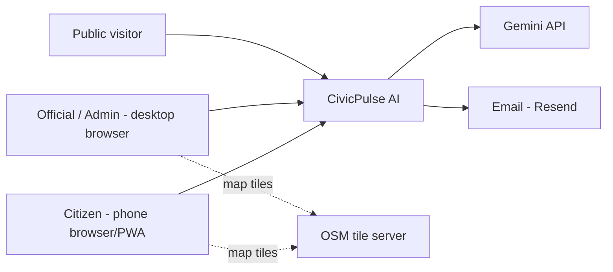
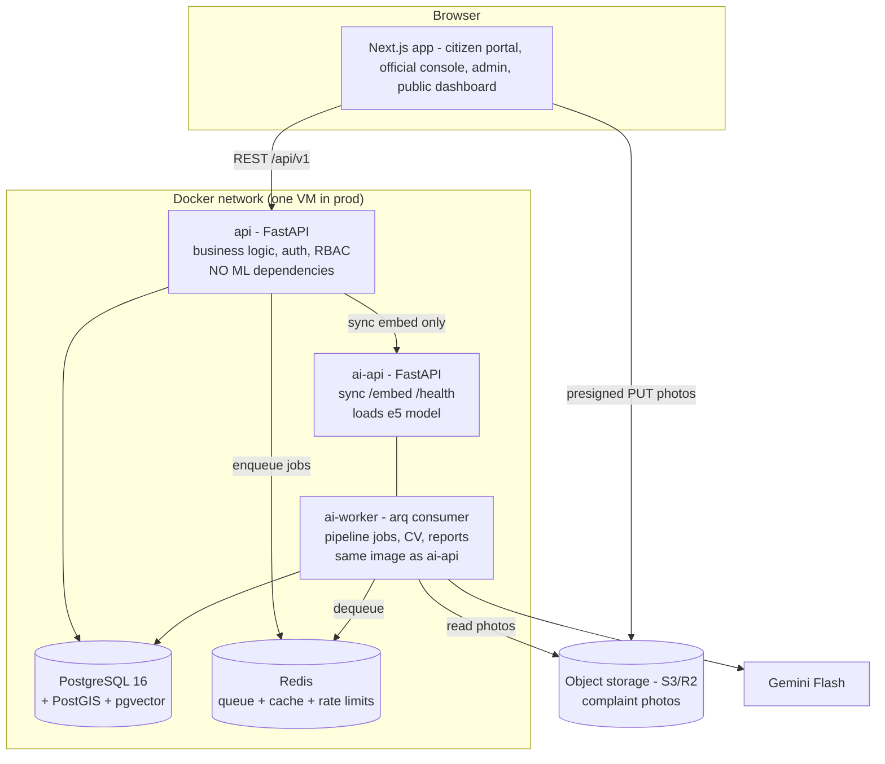

# Architecture — CivicPulse AI

## System context



## Container diagram (what actually runs)



**Five running services, two codebases, three Docker images:**

| Service | Image | Why it exists |
|---|---|---|
| `frontend` | node (Next.js) | All UIs in one app, role-based layouts |
| `api` | python slim (~200 MB) | Business logic. No torch/ultralytics — fast builds, fast cold starts |
| `ai-api` + `ai-worker` | python ML (~2–3 GB) | Same image, two commands (`uvicorn` vs `arq`). Heavy deps isolated here |
| `postgres`, `redis` | official | Data + queue |

This is the honest version of "microservice-friendly": **one real service boundary** (API vs AI), drawn where the dependency weight and scaling profile actually differ — not ten nano-services. The queue is the seam; if CV load ever grows, you scale `ai-worker` replicas without touching anything else.

## The async pipeline is the spine

Everything AI happens **off the request path** (see F8 in 02-user-flows.md). The API's job is: validate → persist → enqueue → return 201 in <300 ms. The worker's job is: take its time, retry safely, write decisions + confidence back. The only synchronous AI call in the system is `/embed` for similar-check, because the citizen is actively waiting — and a 384-d sentence embedding on CPU is ~20 ms.

Rules:
1. Jobs carry IDs, not data. Workers re-read state from Postgres (no stale blobs).
2. Every job is idempotent — re-running `process_complaint` on a triaged complaint is a no-op.
3. Every step logs to `ai_jobs` (model, latency, confidence). When dedup misbehaves, you debug from data, not vibes.
4. Worker crash → arq re-delivers. 3 failures → complaint parked `needs_manual_triage`, never lost.

## Repository structure (monorepo)

```
civicpulse/
├── docs/                      # these documents
├── frontend/                  # Next.js 15 + TS strict + Tailwind + shadcn/ui
│   └── src/app/(public) (citizen) (console) (admin)
├── backend/
│   ├── pyproject.toml         # uv; dependency groups: [api] light, [ai] torch etc.
│   ├── app/
│   │   ├── core/              # config, security (JWT, argon2), deps (RBAC)
│   │   ├── models/            # SQLAlchemy 2.0 + GeoAlchemy2 + pgvector types
│   │   ├── schemas/           # Pydantic v2 (single source of API truth)
│   │   ├── api/v1/            # routers: auth, complaints, issues, analytics, admin...
│   │   ├── services/          # domain logic (issue lifecycle, SLA, priority)
│   │   └── ai/                # pipeline steps, llm adapter (gemini/mock), cv, embeddings
│   ├── workers/               # arq task definitions + cron schedule
│   ├── ai_api/                # tiny FastAPI app: /embed /health
│   ├── alembic/               # migrations
│   └── tests/
├── ml/                        # notebooks: YOLO fine-tune, eval sets, threshold tuning
│   └── eval/                  # labeled data + metric scripts (committed!)
├── scripts/seed.py            # synthetic city data generator
├── docker-compose.yml         # dev: pg, redis, api, ai, frontend, all hot-reload
├── docker-compose.prod.yml    # prod overrides + caddy
└── .github/workflows/ci.yml   # ruff, pytest, mypy-light, eslint, tsc, build
```

One backend codebase, two images: `uv sync --group api` for the slim image, `--group ai` for the ML image. Shared `models/` and `schemas/` can't drift apart — the classic microservice failure for solo devs.

## Architecture Decision Records

### ADR-01 — Modular monolith + one AI service, not microservices
**Decision:** Two backend deployables (api, ai) with module boundaries inside each.
**Why:** Microservices solve org-scaling problems you don't have, and cost you distributed debugging, network failure modes, and deploy complexity you can't afford solo. The requirement "microservice-friendly" is satisfied by clean module seams + queue decoupling — splitting later is mechanical.
**Revisit when:** a second team works on this, or one component needs independent scaling for real load.

### ADR-02 — pgvector replaces FAISS
**Decision:** Embeddings live in Postgres (`vector(384)` + HNSW). FAISS removed from the stack.
**Why:** Dedup needs *filtered* similarity (category + radius + open-status + vector). With FAISS that's two systems to sync, no persistence story, no transactional consistency. At your scale (≤ a few hundred thousand complaints), pgvector is faster to build, impossible to desync, and the SQL is interview gold. FAISS earns its place at tens of millions of vectors with pure ANN workloads.
**Revisit when:** >5–10 M vectors or recall/latency targets pgvector can't hit.

### ADR-03 — PostGIS is mandatory, not optional
**Decision:** PostGIS for all geospatial work: ward point-in-polygon, ST_DWithin dedup radius, grid heatmaps, ST_ClusterDBSCAN hotspots.
**Why:** Half the product's features are geospatial. Doing this in Python (shapely loops over rows) is 100× slower and a re-implementation of solved problems. The original spec listed plain PostgreSQL — that was the single biggest gap.

### ADR-04 — arq for the queue (Redis), not Celery
**Decision:** arq (asyncio-native, by the pydantic author) + Redis.
**Why:** Pairs with FastAPI's async model, ~zero config, has cron. Celery is the resume keyword but is heavyweight, sync-first, and notoriously painful on Windows dev. Redis also serves cache + rate limiting (one infra piece, three jobs).
**Trade-off:** arq is less famous. The queue concepts (idempotency, retries, backoff, DLQ-pattern) transfer 1:1 to Celery/SQS — say that in interviews.

### ADR-05 — One ML image, two processes (ai-api + ai-worker)
**Decision:** Same Docker image runs uvicorn (sync embed) and arq (pipeline) as two compose services.
**Why:** The embed model must serve synchronously (similar-check UX); everything else is async. Two services from one image = one dependency set, no model-version skew, independent scaling knobs.

### ADR-06 — Object storage with presigned URLs (S3 or R2)
**Decision:** Photos go browser → storage directly via presigned PUT; API stores only `object_key`. Cloudflare R2 preferred (S3-compatible, zero egress fees) with S3 as the AWS-native alternative. **Dev/demo runs MinIO in docker-compose** — same S3 API, zero external accounts; prod swaps endpoint + credentials only.
**Why:** Proxying 8 MB uploads through FastAPI burns your single VM's bandwidth and blocks workers. Presigned URLs are the industry pattern and were missing from the original spec entirely.

### ADR-07 — Auth: build JWT properly, in-house
**Decision:** argon2id hashing, 15-min access JWT, rotating refresh in httpOnly cookie with family reuse-detection, RBAC as FastAPI dependencies.
**Why:** For a portfolio project, auth built correctly *is* the learning objective; Clerk/Auth0 would hide it. The risk of DIY auth is mitigated by following the standard recipe exactly (no inventions).
**Revisit when:** this ever fronts real citizens — then add managed identity/OTP via a provider.

### ADR-08 — Embeddings: `intfloat/multilingual-e5-small` (384-d)
**Decision:** Multilingual model, not an English-only MiniLM.
**Why:** Real complaints arrive in Hindi/Hinglish/English mixed. e5-small handles 100+ languages, runs ~20 ms/sentence on CPU, 384-d keeps the index small. **Gotcha:** e5 requires `"query: "` / `"passage: "` prefixes — forget them and similarity quality silently degrades. Pin the model; changing it means re-embedding everything.

### ADR-09 — CV strategy: Gemini Vision zero-shot first, YOLO fine-tune second
**Decision:** P4 starts with Gemini Flash vision ("is this a pothole/garbage/waterlogging? severity? junk/spam?") for instant capability, then fine-tunes YOLOv11n on RDD2022 (road damage, includes India imagery) + a garbage dataset for the on-prem, measurable, resume-worthy detector. CPU inference in the worker (~200–300 ms, fine async).
**Why:** Zero-shot ships value in a day and provides the moderation signal; fine-tuning proves real CV skill with honest mAP numbers.
**Honesty notes:** (a) "water leakage detection" from citizen photos is mostly not visually distinguishable from wet road — the detectable class is **waterlogging/standing water**; spec adjusted. (b) Ultralytics YOLO is **AGPL-3.0**: fine for an open-source student repo, a licensing decision for any commercial deployment (alternatives: RT-DETR, RF-DETR, paid Ultralytics license). (c) CV **verifies and enriches, never gates** — a false negative must not block a citizen.

### ADR-10 — Forecasting: classical stats, not deep learning
**Decision:** SARIMA (statsmodels) on weekly `daily_stats` aggregates per ward×category; KDE/DBSCAN hotspots; rate-ratio test for "emerging".
**Why:** With months (not years) of data, deep forecasting is résumé theater — it would overfit noise. Classical models with confidence intervals and a minimum-history rule are defensible to any interviewer and to any statistician.
**Revisit when:** 2+ years of real data exist.

### ADR-11 — LLM behind an adapter; Gemini Flash as provider
**Decision:** All LLM calls go through `app/ai/llm.py` interface: `classify()`, `title()`, `narrate_report()`, `hypothesize_causes()`, `vision_check()`. Providers: `gemini` | `mock`. `MOCK_AI=true` returns deterministic fixtures.
**Why:** Free-tier quotas, demo-day wifi, provider swaps, and tests all demand the seam. The LLM **never receives raw PII** (strip names/emails from prompts) and **never invents numbers** (report prompts pass computed stats; the model only narrates).

### ADR-12 — Maps: MapLibre GL JS + OpenStreetMap tiles
**Decision:** MapLibre (open-source Mapbox fork) + OSM raster tiles; heatmap via built-in heat layer; geocoding via Nominatim (respect 1 req/s policy) only where needed.
**Why:** Google Maps JS requires billing setup and gets expensive; MapLibre is free, and "I built this on open geo stack" is a better story. Ward polygons render as a vector layer from your own GeoJSON.

### ADR-13 — Single-tenant, single city
**Decision:** One deployment = one city. No `city_id` columns, no tenant routing.
**Why:** Multi-tenancy roughly doubles schema/auth/test complexity for zero demo value. Deploy a second compose stack if you ever need a second city.

## Security architecture (checklist, enforced in P6 review)

- [ ] argon2id; constant-time comparisons; generic auth errors (no enumeration)
- [ ] Refresh rotation + family revocation; access token in memory only
- [ ] RBAC dependency on **every** router; deny-by-default; officials row-scoped to dept/wards
- [ ] Pydantic validates everything inbound; file uploads: mime + size + magic-bytes check on confirm
- [ ] Rate limits (Redis): auth 5/min/IP, complaints 10/day/user, similar-check 20/min
- [ ] EXIF stripped on public serve; public endpoints expose zero reporter PII; locations rounded on public map
- [ ] Secrets via env only; `.env` gitignored; prod secrets in VM env/SSM — never in compose files
- [ ] HTTPS everywhere (Caddy auto-TLS); CORS locked to the frontend origin; security headers (CSP, HSTS)
- [ ] SQL via SQLAlchemy parameters only (the PostGIS string-building trap — never f-string a coordinate)
- [ ] Audit: who did what when = `issue_status_history` + `corrections` (append-only)
- [ ] Dependency scanning: `uv lock` + `pip-audit`, `pnpm audit` in CI

## Deployment

**Dev (your Windows machine):** Docker Desktop (WSL2). `docker compose up` → everything hot-reloads. No native Python/Postgres on Windows needed — this sidesteps every Windows-specific ML/GIS install problem.

**Prod (AWS, ~$10–12/month):**
```
Lightsail or EC2 t3.small (2 GB)        ← start here, not ECS/EKS
 └─ docker compose -f compose.yml -f compose.prod.yml up -d
     ├─ caddy (auto-HTTPS, reverse proxy: / → frontend, /api → api)
     ├─ frontend (next start)
     ├─ api · ai-api · ai-worker
     ├─ postgres (volume) · redis
     └─ nightly: pg_dump → R2/S3 (cron)
```
**Why not ECS/EKS/Lambda:** orchestration is a cost center until you have traffic. The compose file *is* your infrastructure-as-code story; the migration path (ECR images → ECS services → RDS) is a documented paragraph, not a prerequisite. Watch the 2 GB RAM: torch + e5 + YOLO ≈ 1.2 GB in the AI image — if tight, go t3.medium or quantize/onnx-export the models.

**Observability (free tier):** structured JSON logs (structlog) → `docker logs`; Sentry free plan for API + frontend errors; `/health` endpoints on every service; UptimeRobot ping. `ai_jobs` table doubles as pipeline metrics (latency, failure rate by step — chart it in the admin UI).
